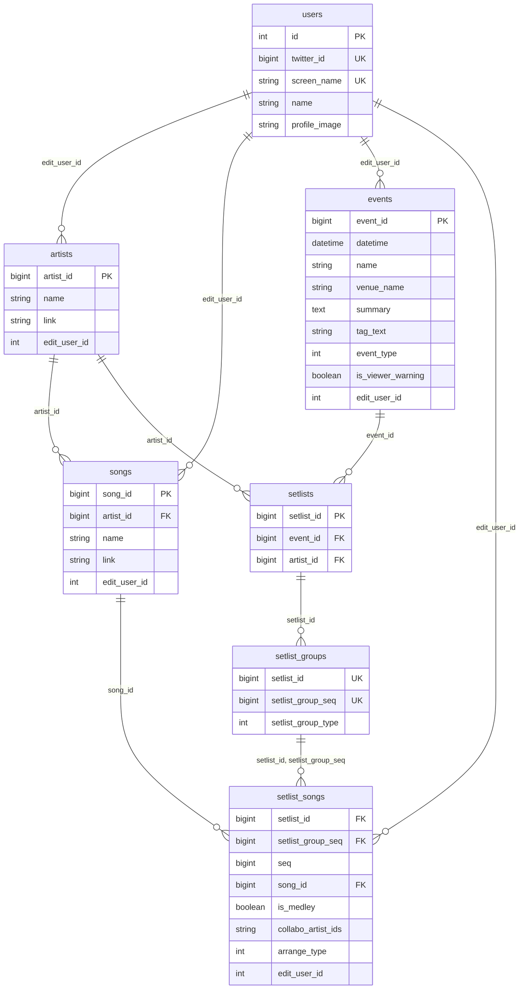

# setlist

ライブ・イベントのセットリストを登録・検索・集計管理する Web アプリケーションです。  
1 つのイベントに対して複数アーティストのセットリストを紐づける設計となっており、ワンマンライブからフェス・対バンイベントまで一貫して記録し、アーティストごとの楽曲演奏傾向を集計・分析できます。

> 開発当初の設計メモは [docs/README_memo.md](docs/README_memo.md) に退避しています。

---

## 主な機能

- **イベント管理**
  - イベントの作成・編集・削除、直近イベントの一覧表示（ページネーション対応）
  - キーワード検索（イベント名・概要・会場名・タグ、またはアーティスト名完全一致）および期間指定検索
  - 概要欄に含まれる URL の自動リンク化
  - ツアー中のネタバレ防止を目的とした **閲覧注意フラグ**（セットリスト領域を折りたたみ表示）
- **セットリスト管理**
  - 1 イベントに対して複数アーティストのセットリスト（通常 / アンコール）を登録・編集・削除
  - ショート Ver、アレンジ種別（Acoustic / Original / Christmas / R&B / 英語 / 中国語 / その他）、コラボアーティスト（複数指定・全員コラボ `ALL` 対応）の記録
  - 他アーティスト楽曲のカバー演奏に対応（`曲名(原曲アーティスト名)` 形式で区別）
  - JavaScript による楽曲入力行の動的追加・削除および `<datalist>` を用いた楽曲名補完
- **アーティスト管理**
  - アーティストの登録・編集・一覧表示・キーワード検索
  - アーティスト詳細ページでの **月別イベント出演カレンダー** 表示（各日付の出演件数表示と、該当日イベント検索へのリンク）
- **楽曲管理**
  - 楽曲の登録・編集・削除・キーワード検索
  - 楽曲詳細ページでの累計歌唱回数および演奏されたイベント一覧の表示
  - **Spotify Web API 連携**によるアーティスト楽曲マスタの自動一括取り込み
- **集計機能**
  - アーティストごと・期間指定でのライブ出演回数および楽曲別の演奏回数・採用率・初回/最終演奏日の集計
  - 未演奏曲（0 回）を含む一覧表示と、「自身の楽曲のみ表示（カバー除外）」フィルタ
  - 回数 / 採用率 / 初回日付 / 最終日付での降順ソート切り替え
- **認証・編集履歴**
  - Twitter OAuth（Laravel Socialite）によるログイン（閲覧・検索はログイン不要、登録・編集・削除はログイン必須）
  - 各データ（イベント・セットリスト・アーティスト・楽曲）の最終編集者と相対更新時刻（例: `3日前`）の表示

---

## 工夫した点（技術・設計のポイント）

1. **フェス・対バン・カバー・コラボを網羅した 4 階層データモデル**
   - `events` → `setlists` → `setlist_groups`（通常 / アンコール）→ `setlist_songs` の 4 階層で正規化し、1 イベントに複数アーティストが出演するフェスや対バンでもアーティスト単位で正確に集計できるようにしました。
   - 演奏曲の `song.artist_id` と `setlist.artist_id` を比較することでカバー曲を自動判別し、表示・入力候補ともに `曲名(原曲アーティスト名)` として識別できるようにしています。
2. **新曲にも公平な「採用率」算出と快適なクライアントサイド集計 UI**
   - 採用率を「期間内の全ライブ数」ではなく **「その楽曲が初回演奏された日以降のライブ数」** を分母として算出することで、リリース時期が新しい楽曲でも傾向を把握しやすくしました。
   - 集計データを JSON でフロントエンドへ渡し、「自楽曲のみ表示」フィルタや 4 軸ソート（回数・採用率・初回日付・最終日付）をリロードなしで即時反映させています。
3. **Spotify Web API を活用した楽曲マスタ登録の省力化**
   - 楽曲の手動登録コストを下げるため、Spotify Web API からアーティストのトラックをページネーション＋インターバル付きで一括取得する機能を実装しました。
   - 取得データから括弧付き別表記や `Instrumental` / `TV Size` / `Remix` / `off vocal` などのノイズ表記、大文字小文字違いの重複を自動フィルタリングしてマスタへ登録します。
4. **実運用を意識した UX とデータ整合性の担保**
   - ツアー期間中のネタバレに配慮した「閲覧注意フラグ（Bootstrap Collapse による折りたたみ）」を導入しました。
   - イベント・セットリストの保存・削除には DB トランザクションを使用し、途中失敗時の部分更新を防止しています。
   - `EventType` / `ArrangeType` を `app/Util/ConstantManager.php` に一元管理し、DB 保存値との不整合を防ぐ拡張ルールを設けています。

---

## 技術スタック

| カテゴリ | 技術・ライブラリ |
| --- | --- |
| バックエンド | PHP `^7.4`, Laravel `^6.0` |
| データベース | MySQL |
| フロントエンド | Blade, Bootstrap 4, jQuery, `pickadate.js`（日付・時刻入力）, Laravel Mix |
| 認証 | `laravel/socialite`（Twitter OAuth） |
| 外部 API 連携 | `jwilsson/spotify-web-api-php`（Spotify Web API） |
| 主な Composer パッケージ | `laravelcollective/html`, `doctrine/dbal`, `orangehill/iseed`（dev） |
| テスト・開発環境 | PHPUnit `^8.0`, Laravel Homestead |

---

## 画面一覧

閲覧・検索系の画面は未ログインで利用でき、登録・編集・削除系は Twitter OAuth ログイン（`auth` ミドルウェア）が必要です。未認証で保護ルートへアクセスした場合は `403` エラーページを返します。

| 画面名 | パス | 認証 | 概要 |
| --- | --- | :---: | --- |
| ホーム（トップ） | `/`（`/index`） | 不要 | サイト概要と過去の直近イベント一覧（15 件/ページ） |
| イベント検索 | `/events/search` | 不要 | キーワード・期間指定でのイベント検索、単日指定時の新規作成導線 |
| イベント詳細 | `/events/{event_id}` | 不要 | イベント情報・複数アーティストのセットリスト表示（閲覧注意折りたたみ対応） |
| イベント追加 / 編集 | `/events/create`, `/events/{event_id}/edit` | **必要** | 日付・開始時間・イベント名・会場・概要・種別・タグ・閲覧注意フラグの登録/編集 |
| セットリスト追加 / 編集 | `/events/{event_id}/setlist/{artist_id}` | **必要** | 通常・アンコール楽曲の動的入力フォーム（ショート・アレンジ・コラボ対応） |
| アーティスト一覧 | `/artists` | 不要 | アーティスト一覧（15 件/ページ）および検索フォーム |
| アーティスト検索 | `/artists/search` | 不要 | アーティスト名の部分一致検索 |
| アーティスト詳細 | `/artists/{artist_id}` | 不要 | 月別出演カレンダー、集計ページ導線、登録楽曲一覧、Spotify 取り込み導線 |
| アーティスト追加 / 編集 | `/artists/add`, `/artists/{artist_id}/edit` | **必要** | アーティスト情報の登録/編集 |
| 楽曲検索 | `/songs/search` | 不要 | 楽曲名の部分一致検索（アーティスト名付き表示） |
| 楽曲詳細 | `/songs/{song_id}` | 不要 | 楽曲情報、累計歌唱回数、演奏されたイベント一覧 |
| 楽曲追加 / 編集 | `/songs/add`, `/songs/{song_id}/edit` | **必要** | 楽曲名・紐づくアーティストの登録/編集 |
| 集計トップ | `/aggregate` | 不要 | 集計対象アーティストの選択一覧 |
| 集計詳細 | `/aggregate/show/{artist_id}` | 不要 | 期間指定の演奏回数ランキング（採用率・初回/最終日・フィルタ・ソート機能） |
| Spotify 楽曲取り込み | `/generateMaster/{artist_id}` | **必要** | Spotify OAuth 経由で対象アーティストの楽曲マスタを一括取り込み |
| Twitter OAuth 認証 | `/auth/twitter`, `/auth/twitter/callback`, `/auth/twitter/logout` | 不要 | ログイン・コールバック・ログアウト処理 |
| エラー画面 | `403` / `404` / `500` | - | 各 HTTP ステータスに応じたカスタムエラー画面 |

---

## テーブル設計

### ER 図



### テーブル定義一覧

各テーブルには共通して `created_at` / `updated_at` / `deleted_at` カラムを持ちます。

#### `users`（ユーザー）
| カラム名 | 型 | 制約 | 説明 |
| --- | --- | --- | --- |
| `id` | `int` | PK, AI | ユーザー ID |
| `twitter_id` | `bigint` | UNIQUE | Twitter ユーザー ID |
| `screen_name` | `string` | UNIQUE | 表示名 |
| `name` | `string` | - | Twitter アカウント名 |
| `profile_image` | `string` | NULL 可 | プロフィール画像 URL |
| `remember_token` | `string` | NULL 可 | ログイン保持トークン |

#### `artists`（アーティスト）
| カラム名 | 型 | 制約 | 説明 |
| --- | --- | --- | --- |
| `artist_id` | `bigint` | PK, AI | アーティスト ID |
| `name` | `string` | - | アーティスト名 |
| `link` | `string` | NULL 可 | 公式サイト等のリンク |
| `edit_user_id` | `int` | DEFAULT `0` | 最終編集ユーザー ID（`0` は管理者） |

#### `songs`（楽曲）
| カラム名 | 型 | 制約 | 説明 |
| --- | --- | --- | --- |
| `song_id` | `bigint` | PK, AI | 楽曲 ID |
| `artist_id` | `bigint` | - | 原曲アーティスト ID |
| `name` | `string` | - | 楽曲名 |
| `link` | `string` | NULL 可 | 商品・配信ページ等のリンク |
| `edit_user_id` | `int` | DEFAULT `0` | 最終編集ユーザー ID |

#### `events`（イベント）
| カラム名 | 型 | 制約 | 説明 |
| --- | --- | --- | --- |
| `event_id` | `bigint` | PK, AI | イベント ID |
| `datetime` | `datetime` | - | 開催日時 |
| `name` | `string` | - | イベント名 |
| `venue_name` | `string` | - | 会場名 |
| `summary` | `text` | NULL 可 | イベント概要（URL 自動リンク対応） |
| `tag_text` | `string` | NULL 可 | タグ（カンマ区切り） |
| `event_type` | `int` | DEFAULT `0` | イベント種別（`0`: ワンマン, `1`: FC イベント, `2`: フェス, `3`: ミニライブ, `4`: イベント, `5`: その他） |
| `is_viewer_warning` | `boolean` | DEFAULT `false` | 閲覧注意フラグ（ネタバレ防止の折りたたみ制御） |
| `edit_user_id` | `int` | DEFAULT `0` | 最終編集ユーザー ID |

#### `setlists`（セットリスト）
| カラム名 | 型 | 制約 | 説明 |
| --- | --- | --- | --- |
| `setlist_id` | `bigint` | PK, AI | セットリスト ID |
| `event_id` | `bigint` | - | イベント ID |
| `artist_id` | `bigint` | - | 出演アーティスト ID |

#### `setlist_groups`（セットリストグループ）
| カラム名 | 型 | 制約 | 説明 |
| --- | --- | --- | --- |
| `setlist_id` | `bigint` | 複合 UNIQUE | セットリスト ID |
| `setlist_group_seq` | `bigint` | 複合 UNIQUE | グループ連番（`0`: 通常, `1`: アンコール） |
| `setlist_group_type` | `int` | DEFAULT `0` | グループ種別（`0`: 通常, `1`: アンコール） |

#### `setlist_songs`（セットリスト楽曲）
| カラム名 | 型 | 制約 | 説明 |
| --- | --- | --- | --- |
| `setlist_id` | `bigint` | - | セットリスト ID |
| `setlist_group_seq` | `bigint` | - | グループ連番（`0`: 通常, `1`: アンコール） |
| `seq` | `bigint` | - | 曲順（0 始まり） |
| `song_id` | `bigint` | - | 楽曲 ID |
| `is_medley` | `boolean` | DEFAULT `false` | ショート Ver フラグ（画面上は `short.ver` として表示） |
| `collabo_artist_ids` | `string` | - | コラボアーティスト ID のカンマ区切り（`0` は全員コラボ `ALL`） |
| `arrange_type` | `int` | - | アレンジ種別（`0`: 通常, `1`: Acoustic, `2`: Original, `3`: Christmas, `4`: R&B, `5`: その他, `6`: 英語, `7`: 中国語） |
| `edit_user_id` | `int` | DEFAULT `0` | 最終編集ユーザー ID |

---

## セットアップ・よく使うコマンド

### 初回セットアップ

```bash
# 1. 依存パッケージのインストール
composer install
npm install

# 2. 環境設定ファイルの作成（DB・Twitter OAuth・Spotify API の設定を記述）
cp .env.local.example .env
php artisan key:generate

# 3. マイグレーション・初期データ投入
php artisan migrate
php artisan db:seed
```

### 開発・ビルド・テスト

```bash
# ローカル開発サーバー起動
php artisan serve

# フロントエンドアセットのビルド（Laravel Mix）
npm run dev       # 開発用ビルド
npm run watch     # ファイル監視ビルド
npm run prod      # 本番用ビルド

# テスト実行（PHPUnit）
vendor/bin/phpunit

# 現在の DB データから Seeder を生成（orangehill/iseed）
php artisan iseed artists,songs,events,setlists,setlist_groups,setlist_songs --force
```

---

## 権利表記

### ライセンス
本プロジェクトは [MIT License](https://opensource.org/licenses/MIT) のもとで公開されています。

### サードパーティライブラリ・サービス
本アプリケーションでは以下のオープンソースソフトウェアおよび外部サービスを利用しています。各ライブラリ・サービスの著作権およびライセンスはそれぞれの権利者に帰属します。

- [Laravel](https://laravel.com/) / [Laravel Socialite](https://github.com/laravel/socialite)（MIT License）
- [Bootstrap](https://getbootstrap.com/) / [jQuery](https://jquery.com/)（MIT License）
- [pickadate.js](https://amsul.ca/pickadate.js/)（MIT License）
- [LaravelCollective HTML](https://github.com/LaravelCollective/html)（MIT License）
- [spotify-web-api-php](https://github.com/jwilsson/spotify-web-api-php)（MIT License）
- [iSeed (orangehill/iseed)](https://github.com/orangehill/iseed)（BSD-2-Clause License）
- Twitter OAuth / Spotify Web API（各社の利用規約に準拠）
